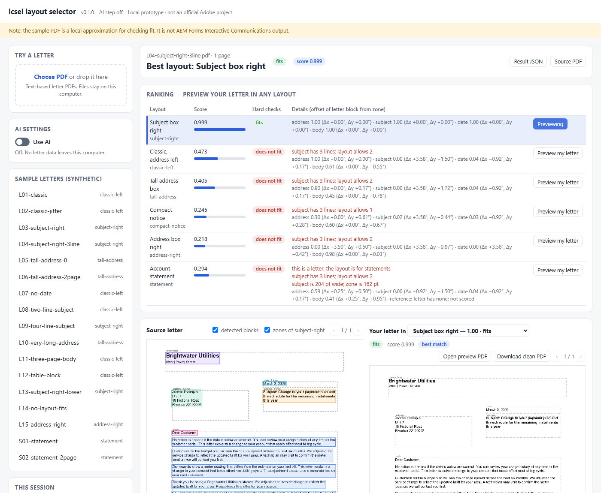
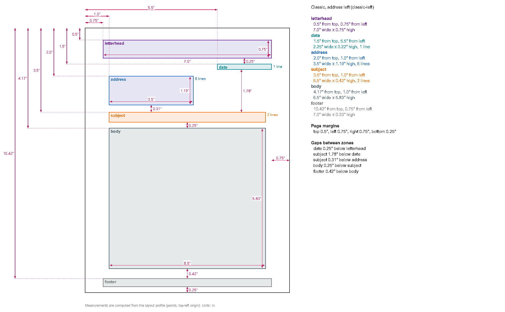
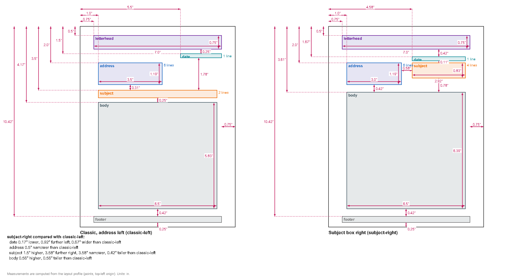
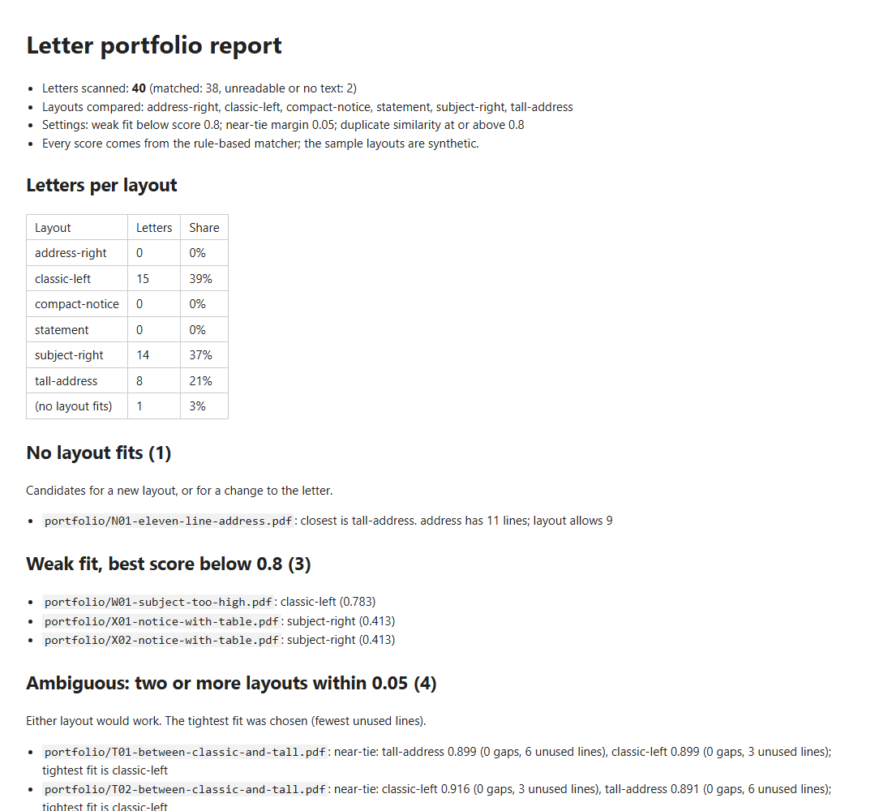

# icsel: pick a layout for a letter PDF

[](https://github.com/snbaem/interactive-comm/actions/workflows/ci.yml)

`icsel` is a local prototype for people who work with AEM Forms Interactive Communications (IC).
Given a text-based letter PDF, it compares the position and size of the letter's blocks with a
small set of layout profiles, ranks the layouts with a reason for each, and renders a sample of
the letter in the best one. It can also summarize a whole folder of letters. The matching is
rule-based and runs offline; an optional AI step, off by default, only fills gaps.

> **Not an official Adobe project.** It is not affiliated with, endorsed by or
> supported by Adobe. Product names are used only to describe compatibility.
>
> **Fidelity:** the sample PDF is a local approximation for checking fit. It is
> not AEM Forms Interactive Communications output. icsel does not read IC templates.

All data in this repository is synthetic. The company, *Brightwater Utilities*,
is fictional, and so is every name, address and account number.



## Quick start (5 minutes)

Requires Python 3.10 or newer.

**Windows (PowerShell)**

```powershell
git clone https://github.com/snbaem/interactive-comm.git
cd interactive-comm
python -m venv .venv
.venv\Scripts\Activate.ps1
python -m pip install -e ".[dev]"
icsel samples
icsel match samples\letters\L04-subject-right-3line.pdf
icsel serve --open
```

**macOS / Linux (bash)**

```bash
git clone https://github.com/snbaem/interactive-comm.git
cd interactive-comm
python3 -m venv .venv
source .venv/bin/activate
python -m pip install -e ".[dev]"
icsel samples
icsel match samples/letters/L04-subject-right-3line.pdf
icsel serve --open
```

`icsel match` prints the ranking and why other layouts were ruled out:

```text
L04-subject-right-3line.pdf
  subject-right         0.999  fits
  classic-left          0.473  DOES NOT FIT
      - subject has 3 lines; layout allows 2
  ...
  Best layout: subject-right
```

It writes two files per letter to `out/`: `<letter>.result.json` (detected blocks and
per-layout scores) and `<letter>.sample.pdf`. `icsel serve` opens the browser UI; stop it with
Ctrl+C.

## What it can do

| | Command | More |
| --- | --- | --- |
| Rank layouts for a letter and render a sample | `icsel match` | [How it works](#how-it-works) |
| Try letters in a browser | `icsel serve` | [Browser UI](#browser-ui) |
| Summarize a folder: fits, gaps, near-duplicates, shared text, draft layouts | `icsel portfolio` | [Portfolio mode](#portfolio-mode) |
| Draw and compare layouts with measurements | `icsel show-layout` | [Layout views](#layout-views) |
| Draft a layout profile from a PDF | `icsel profile` | [Layout profiles](docs/profile-schema.md) |
| Let a model fill gaps (opt-in) | `--llm` | [Optional AI step](#optional-ai-step-off-by-default) |
| Measure rules and AI tasks on known answers | `icsel eval` | [Benchmark](#benchmark-icsel-eval) |

Documents: [architecture](docs/architecture.md), [profile and settings format](docs/profile-schema.md),
[bringing your own layouts in](docs/getting-real-templates-in.md),
[open questions for production](docs/production-path.md), [recipe draft](docs/recipe-draft.md),
[plan](docs/PLAN.md), [reviewer checklist](REVIEW.md).

## Layout views

`icsel show-layout classic-left` draws a layout with its measurements:



`icsel show-layout classic-left --compare subject-right` puts two layouts side by side and lists
the differences:



## Browser UI

```bash
icsel serve --open
```

This starts a small local web app at <http://127.0.0.1:8765/>. If that port is
busy, it uses the next free one and prints the address. You can:

- click a synthetic sample letter, or drop your own text-based PDF;
- see the ranking with each layout's hard-check failures and per-block offsets;
- view the source letter with its detected blocks and the layout zones drawn on top,
  beside the sample rendered in that layout;
- preview your own letter's content in **any** layout: use the *Preview my letter*
  button on a ranking row or the *Your letter in* picker above the sample. When the best
  score is below 0.8, or no layout fits, a hint offers one button per layout;
- every part of your letter appears in the preview. Text goes into the box for its
  role. Anything the layout has no box for (an unrecognized heading, a table, a
  date when the layout has no date box) flows into the body area in reading order
  with an amber background, and side-by-side blocks stay together as a table.
  Text that does not fit its box is drawn in red and labeled, for example
  `address: 2 lines over the box (6 max)`.
- *Open preview PDF* shows the boxes, labels and highlights. *Download clean PDF*
  gives your letter in that layout without them, which is the one to save or share.
  Either one can be uploaded again: icsel ignores its own labels, so the layout it was
  made in scores close to 1.0.

The server uses only the Python standard library. It listens on `127.0.0.1` and
makes no outbound calls unless you turn on the AI step. Uploads and results go to `out/web/`. Stop it with
Ctrl+C. Do not expose it with `--host 0.0.0.0` on a shared network: it has no
authentication.

## Optional AI step (off by default)

The rules cannot label every block of a real letter: an unlabeled heading, a
placeholder like `[Date]`, a table. An optional AI step can:

1. **label blocks the rules left `unknown`**, so they count in the score and land in
   the right box of the preview;
2. **explain the fit** in one short paragraph, based on the scores.

It is off unless you turn it on, and it never changes what the rules already
labeled. The explanation is only requested when the rules flag a weak fit, a near-tie or
no fit; it is shown after the rule-based text. It only fills gaps: no second address, date or
subject, and only above a confidence threshold. Everything the AI changed is marked `role_source: "llm"` in
the result JSON and with an **AI** badge in the browser UI.

**In the browser UI:** install the extra (`python -m pip install -e ".[llm]"`), run
`icsel serve --open`, and switch on **Use AI** under *AI settings*. Enter your API key and
choose whether letter text may be sent (off by default: the AI then only explains scores).
*Turn on* checks the key without sending letter data. The key is kept in memory until
icsel stops; it is never written to disk or sent back to the browser. *Forget key* removes
it sooner. The settings are locked when icsel listens on a non-loopback address.

**On the command line**, or to start the UI with AI already on:

```powershell
python -m pip install -e ".[llm]"          # example backend: Claude via the Anthropic SDK
$env:ANTHROPIC_API_KEY = "<your key>"       # or `ant auth login`; never commit a key
icsel match samples\letters --llm anthropic
icsel serve --llm anthropic
```

```bash
python -m pip install -e ".[llm]"
export ANTHROPIC_API_KEY=...                # or `ant auth login`
icsel match samples/letters --llm anthropic
```

`--llm` overrides the `ICSEL_LLM` environment variable. Other settings are
environment variables too (see [`.env.example`](.env.example)): `ICSEL_LLM_MODEL`
(default `claude-opus-5-5`), `ICSEL_LLM_EFFORT` (default `low`),
`ICSEL_LLM_TASKS` (`classify,explain`), `ICSEL_LLM_MIN_CONFIDENCE` (default 0.5)
and `ICSEL_PROMPTS_DIR` to use your own prompt wording. The example backend has
server-side refusal fallbacks on; set `ICSEL_LLM_FALLBACKS=0` on platforms without them.

### Tasks and what each one sends

Pick tasks with `--ai-tasks` or `ICSEL_LLM_TASKS` (default `classify,explain`).

| Task | What it does | What is sent | Opt-in switch |
| --- | --- | --- | --- |
| `classify` | Label blocks the rules left `unknown` | Text of those blocks (up to 600 characters each); positions, sizes and roles of the others | `--llm` |
| `explain` | Explain weak fits, near-ties and no-fits | Scores and offsets. **No letter text** | `--llm` |
| `fragments` | Name shared-text candidates (portfolio) | Only wording that every letter of a group has in common (up to 800 characters). Numbers become `#`; address lines and differing words become `[...]` | `--ai-tasks` |
| `propose` | Name proposed layouts (portfolio) | Box geometry and layout ids. **No letter text**, no file names | `--ai-tasks` |
| `fields` | Find variable fields | **Letter text**: everything except letterhead and footer, so names, addresses and amounts (up to 12,000 characters) | `--ai-tasks` **and** `--fields-send-text` |
| `purpose` | Tag the letter's purpose | **Letter text**: subject line and first body paragraph (up to 800 characters) | `--ai-tasks` **and** `--purpose-send-text` |

The text switches can also be set with `ICSEL_LLM_FIELDS_SEND_TEXT=1` and
`ICSEL_LLM_PURPOSE_SEND_TEXT=1`. **Only enable the AI step for letters you are allowed to
send to the model endpoint you configure.** `ICSEL_LLM_TASKS=explain` sends no letter text
at all. See [`src/icsel/prompts/`](src/icsel/prompts/README.md) for the prompt templates.
`icsel serve` supports `classify` and `explain` only.

Model output is never trusted: every reply is checked against its schema, quoted text must
be an exact substring of the letter, names and purposes must match a pattern or list.
Whatever fails is dropped and counted in the report. Everything kept is flagged as AI.

**Cost control.** `--max-calls N` is a hard cap on model calls. Replies that passed
validation are cached in `out/.ai-cache` (`ICSEL_AI_CACHE_DIR` moves it, `--no-ai-cache`
turns it off), keyed by task, prompt, model and input; failures are never cached. Cached
`fields` replies quote letter text, so treat the folder like the letters themselves.

### Field detection

```bash
icsel match letter.pdf --llm anthropic --ai-tasks fields --fields-send-text
icsel portfolio letters --llm anthropic --ai-tasks fields --fields-send-text --yes
```

> **This sends letter text to the model endpoint**, including names, addresses, account
> numbers and amounts. Use it only for letters you are allowed to send there.

The model marks spans as fixed or variable and suggests a camelCase name for each variable
one. The result JSON gets a `fields` section; portfolio mode writes `fields.csv` (`letter`,
`field`, `text`, `confidence`, `probably_fixed`, `source`) and lists names that recur across
letters. A text that appears identically in two or more letters is marked probably fixed.
A date that a batch happens to share is marked too, so treat the mark as a hint.

`UNVERIFIED`: how these fields would map to Interactive Communications data binding, a form
data model (FDM) or document fragments has not been checked against Adobe documentation.
icsel only suggests names; it creates nothing in AEM. To verify: compare the list with the
data model and fragments of a real template in your own environment.

### Purpose tagging

`--ai-tasks purpose --purpose-send-text` tags each letter with one value of
[`purposes.json`](src/icsel/data/purposes.json); `--purposes FILE` uses your own list
(`{"purposes": ["billing-notice", ...]}`). Anything else the model says becomes `other` and
is counted. Portfolio mode fills the `purpose` column and adds a purpose-by-layout table.

## Benchmark (`icsel eval`)

```bash
icsel samples
icsel eval samples/letters                 # rules only, offline
icsel eval samples/letters --llm anthropic --ai-tasks classify,fields,purpose \
  --fields-send-text --purpose-send-text
```

The synthetic letters come with `truth.json`: the true role of every block, the variable
fields, the purpose and the layout. `icsel eval` scores the rules alone, then the rules plus
each task, and writes `eval.json` and `eval.md`. The report says plainly when a task **does
not beat the rules**. Tokens appear when the backend reports them, a cost only when it also
gives prices. `explain`, `fragments` and `propose` have no metric
here. Boilerplate recall and precision measure the shared-text rules, which run without a
model. The benchmark letters are
synthetic and small; a good score on them says little about your letters.

**Other providers:** the AI step is written against a one-method interface
(`CompletionBackend.complete(system, prompt, json_schema)` in
[`icsel/llm/base.py`](src/icsel/llm/base.py)). To add a provider, implement it and
call `icsel.llm.register_backend("name", factory, api_key_env="NAME_API_KEY")`. A backend may expose `last_usage`
(token name to count) and `prices` (per million tokens) for reports. Prompts, data minimization and
guard rails are shared. Tests use a fake backend and never touch the network.

## Portfolio mode

`icsel portfolio` matches a whole folder of letters and answers "how do our letters
spread across our layouts?". It is deterministic by default and never calls a model
unless you ask it to.

**Windows (PowerShell)**

```powershell
icsel samples --portfolio                     # 40 synthetic files, with deliberate problems
icsel portfolio samples\portfolio
icsel portfolio D:\letters -r --out out\portfolio
```

**macOS / Linux (bash)**

```bash
icsel samples --portfolio
icsel portfolio samples/portfolio
icsel portfolio ~/letters -r --out out/portfolio
```



It writes `portfolio.csv` (one row per PDF, for sorting and filtering) and `portfolio.md`
(the report). The report has:

- **Letters per layout**: how many letters each layout holds, plus a "no layout fits" row.
- **No layout fits**: letters that break a hard check on every layout, with the closest
  layout and why. These are candidates for a new layout or a change to the letter.
- **Weak fit**: letters that fit but score below `--min-score` (default 0.8).
- **Ambiguous**: letters where two or more fitting layouts score within
  `--ambiguity-margin` (default 0.05) of the best one.
- **Near-duplicate letters**, grouped: candidates for shared content.
- **Shared text**, with `--shared-text` (see below).
- **Proposed layouts**, with `--proposals` (see below).
- **Unreadable or no text**: corrupt files and scans are listed, and the run goes on.

**Near-ties.** When fitting layouts are within the margin, the score's last decimal
should not decide. The tightest fit wins: fewest roles without a zone, then fewest unused
lines in the address, subject and date boxes, then the higher score, then the layout id.
The flag stays on, so you still see that either layout would work. The tie-break only
applies in portfolio mode; `icsel match` still ranks by score.

**Duplicates.** Similarity is the Jaccard overlap of the sets of 5-word shingles of the
letters' body paragraphs, after lower-casing and replacing every run of digits with `#`,
so account numbers and amounts do not hide a copy. Pairs at or above
`--duplicate-threshold` (default 0.8) are linked into groups. Comparisons are exact and
pairwise, which is comfortable for a few thousand letters. Bodies shorter than 12 words
are skipped.

**Shared text.** `--shared-text` finds body paragraphs, headers and footers that recur
across letters, with the same 5-word shingles and digit handling as the duplicate check. A
text counts when it appears in at least `shared_text_min_letters` letters (default 2) with a
similarity of `shared_text_threshold` (default 0.8) or more; body paragraphs need
`shared_text_min_words` words (default 8). See `scoring.json`. The groups go to
`shared-text.csv` and `portfolio.md`, most letters first. Each is a *candidate* for a reusable
text fragment. No model is involved; the `fragments` AI task adds a name and a description.
Paragraphs split by a page break, addresses, subjects, greetings, closings and tables are not
compared. Text that is the same in every letter of a group can still be personal, for example
two letters to the same person; address lines are masked before anything is sent, other
wording is not. `UNVERIFIED`: how a candidate would map to an AEM document fragment.

**Proposed layouts.** `--proposals` clusters the weak and no-fit letters: two letters
belong together when none of their address, subject and date boxes starts more than
`cluster_distance` points apart (default 36, see `scoring.json`). Each cluster of at least
`cluster_min_letters` (default 2) becomes a draft profile in `proposals/`, with median box
positions and sizes and a dimensioned view, next to the nearest existing layout. No model is
involved. The `propose` AI task adds a name and a rationale. Drafts are a starting point:
review them, then use them with `--layouts`.

**Memory and size.** Each PDF is read and reduced to one small record, so a folder of
hundreds of PDFs does not need to fit in memory. Every score comes from the rule-based
matcher unless you turn the AI step on.

**AI step.** Add `--llm BACKEND` (see [Optional AI step](#optional-ai-step-off-by-default)).
With the default tasks, portfolio mode only asks the model about letters that need it: letters with blocks the
rules could not label, and letters that are ambiguous, weak or fit no layout. A letter
that fits one layout cleanly makes no call. icsel prints the estimate first, for example
`up to 10 model call(s) for 40 letter(s)`, and asks before sending anything. Pass `--yes`
to skip the question, which is also required when the input is not a terminal. After three
failed letters in a row the AI step stops and the report stays rule-based.
**Only use letters you are allowed to send to your model endpoint.**

Exit code 1 means some files could not be matched (corrupt or no text layer); the
reports are still written.

## Commands

| Command | What it does |
| --- | --- |
| `icsel match PATH...` | Rank layouts for each letter, then write a result JSON and a sample PDF. The sample outlines zones and marks overflowing text in red; `--no-zones` gives a clean page instead. Other options: `--layouts PATH` (repeatable; default is the bundled examples), `--config FILE` (scoring settings, defaults in `src/icsel/data/scoring.json`), `--dimensions`, `--units`, `--out DIR`, `-r/--recursive`, `--llm BACKEND` and the AI options of `portfolio`. |
| `icsel profile PATH...` | Derive a draft layout profile from a PDF. With one PDF it prints to stdout or writes to `-o FILE`. With several, it writes to the `-o DIR` folder (default `profiles/`). |
| `icsel portfolio PATH...` | Match a folder of letters and write `portfolio.csv` and `portfolio.md`: best layout per letter, ambiguous and weak fits, letters per layout, letters that fit no layout, near-duplicate groups and unreadable files. Options: `--layouts`, `--out DIR` (default `out/portfolio`), `-r/--recursive`, `--config`, `--min-score`, `--ambiguity-margin`, `--duplicate-threshold`, `--shared-text`, `--proposals`, `--llm BACKEND`, `--ai-tasks`, `--max-calls N`, `--fields-send-text`, `--purpose-send-text`, `--purposes FILE`, `--no-ai-cache`, `--yes`. |
| `icsel eval PATH...` | Benchmark the rules, and the rules plus each AI task, against `truth.json`; writes `eval.json` and `eval.md`. Options: `--truth FILE`, `--out DIR` (default `out/eval`), `--layouts`, `--config`, `-r/--recursive`, `--yes` and the AI options of `portfolio`. |
| `icsel show-layout LAYOUT` | Draw a layout with distances from the top and left edges, page margins, gaps between zones, sizes and line capacities. `--units in\|cm\|pt`, `--format pdf\|png\|both`, `--compare OTHER` (side by side), `--diff` (overlay `--compare` or `--letter PDF` and list differences), `--json`. `match --dimensions` does the same for each letter's best layout. |
| `icsel serve` | Start the local browser UI (`--port`, `--host`, `--layouts`, `--workdir`, `--open`, `--llm`). |
| `icsel samples` | Generate the synthetic Brightwater Utilities letters (`--out`, default `samples/letters`). With `--portfolio`, generate the 40-file demo folder for `icsel portfolio` instead (default `samples/portfolio`). |

`PATH` can be a file, a folder or a glob pattern such as `letters/*.pdf`. icsel
expands patterns itself, so they work the same in PowerShell, cmd.exe and bash.
File extensions are matched case-insensitively. If a PDF cannot be read, icsel
reports it and moves on to the next file.

## How it works

1. `extract.py` reads words and their positions with pdfplumber, groups them
   into blocks, and labels each block with simple rules: letterhead, date,
   address, subject, salutation, body, closing, footer or unknown.
2. `match.py` scores each layout profile by how close each block sits to its
   zone and how much of it falls inside. Hard checks run first: line capacity,
   width, and required zones.
3. `render.py` draws the letter's text into the winning layout's zones with
   reportlab.

**Statements.** A document with a bold or all-caps "... statement" title, no greeting and a
table of four or more rows is treated as a statement. Its title becomes the subject,
"Label: value" lines become the date and `reference` details, and table cells become
`table`. A statement only fits layouts with `"kind": "statement"` (bundled: `statement`),
and a letter only fits letter layouts, so neither is forced into the other's boxes.

Layout profiles are JSON files, validated on load, measured in points from the top-left
corner of the page ([format](docs/profile-schema.md)). The bundled examples are in
[`src/icsel/data/layouts/`](src/icsel/data/layouts/classic-left.json). See
[architecture](docs/architecture.md) for the scoring formula and the module map.

## Development

```bash
ruff check .
ruff format --check .
pytest
```

See [CONTRIBUTING.md](CONTRIBUTING.md). The tests block network access. The images come from
`python scripts/make_screenshots.py`.

## Limitations

- Only text-based PDFs work. Scanned or image-only PDFs are reported, not read
  with OCR.
- Block detection is rule-based and tuned for typical business letters. The optional
  AI step fills gaps but can be wrong too; check its labels against the scores.
- Portfolio duplicate detection compares all pairs of letters; it is meant for a few
  thousand letters, not millions. It compares body text only, not layout.
- icsel does not read IC templates. Layout profiles are written or corrected by hand.
- Everything was tested on synthetic letters. The layouts and letters were made together, so
  scores on them are close to perfect; scores on other letters will be lower.
- No AI task has been measured with a real model yet. Run `icsel eval` with your backend first.
- Statements are recognized by a few simple rules, tested on one synthetic design.
- Shared text and variable fields are candidates for a person to review.
- The sample PDF approximates placement only. It does not reproduce IC fonts,
  fragments, data binding or pagination.

## License

[Apache License 2.0](LICENSE).
