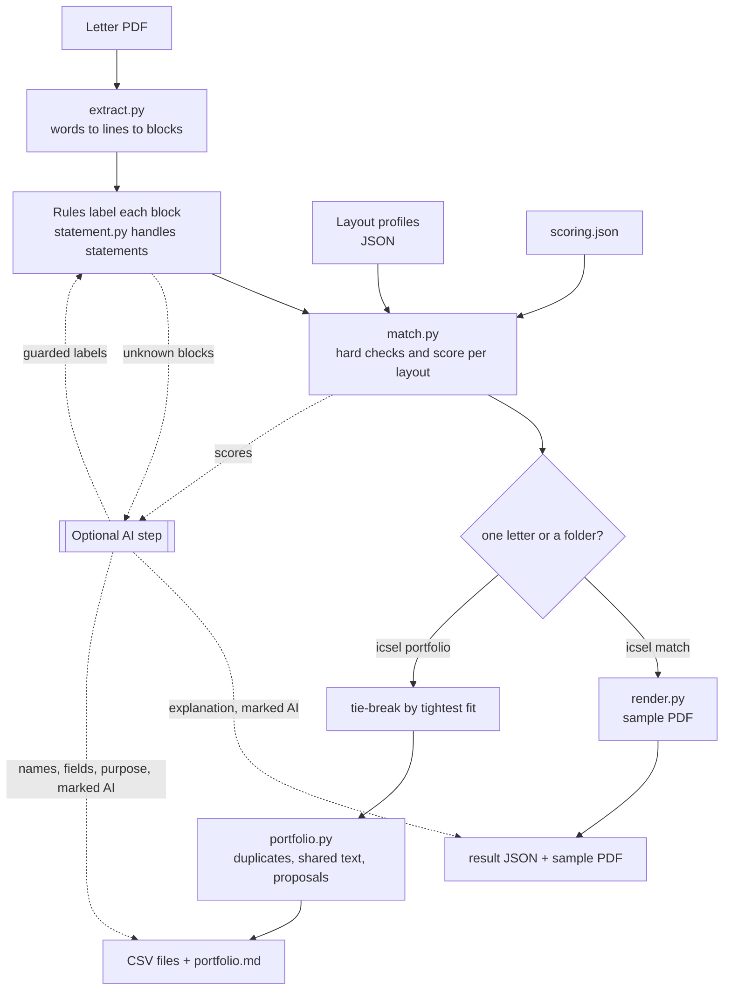

# Architecture

icsel reads a text-based letter PDF, labels its parts, scores a set of layout profiles by
geometry and renders the letter in the chosen one. Rules do all of that. An optional AI step,
off by default, fills gaps and adds suggestions. It never picks the layout.

## Pipeline



Solid arrows always run. Dotted arrows run only when a backend and the task are switched on.

1. **Extraction** (`extract.py`). pdfplumber gives words with positions and fonts. Words become
   lines, lines split at wide horizontal gaps, and lines with a common left edge and normal
   spacing become blocks. A PDF without a text layer raises `NoTextError`; there is no OCR.
2. **Role labels.** Ordered rules give each block one role: letterhead, date, address, subject,
   salutation, body, closing, footer or unknown. `statement.py` recognizes account statements
   (a "... statement" title, no greeting, a table of four or more rows) and adds the roles
   `reference` and `table`.
3. **Hard checks** (`match.py`). A layout does not fit when a block has more lines than its
   zone's `max_lines`, is wider than its zone by more than `width_tolerance`, a `required` zone
   has no block, or the kind (letter or statement) differs. Body length is not a hard check.
4. **Scoring.** For each scored role:

   ```text
   closeness = max(0, 1 - distance(block top-left, zone top-left) / position_scale)
   overlap   = area of the block inside the zone / area of the block
   score     = closeness_share * closeness + (1 - closeness_share) * overlap
   ```

   The total is the weighted mean over the scored roles. A role the letter has but the layout
   has no zone for scores 0; a zone the letter has nothing for is not scored. Layouts that fit
   rank first, then higher scores. Defaults are in
   [profile-schema.md](profile-schema.md#scoringjson).
5. **Tie-break** (portfolio mode only). When fitting layouts are within `tie_margin`, the
   tightest one wins: fewest roles without a zone, then fewest unused lines in the address,
   subject and date boxes, then the higher score, then the layout id.
6. **Rendering** (`render.py`). The letter's text is drawn into the zones with reportlab. Text
   with no zone flows into the body. Overflow is drawn in red. This is a local approximation
   for checking fit. It is not Interactive Communications output.
7. **Explanation** (`explain.py`). A rule-based paragraph that restates the scores.

## Portfolio mode

`icsel portfolio` runs steps 1 to 5 on every PDF, keeps one small record per letter, and adds:

- near-duplicate groups: Jaccard similarity of 5-word shingles of the body, digits normalized;
- shared text (`--shared-text`): paragraphs, headers and footers that recur across letters,
  with the same measure. Each group is a candidate for a reusable fragment;
- layout proposals (`--proposals`): clusters of weak and no-fit letters become draft profiles.

Unreadable files are listed and the run goes on (exit code 1).

## Where AI plugs in

| Task | Input from the rules | What it may add | What it cannot change |
| --- | --- | --- | --- |
| `classify` | Blocks labeled `unknown` | A role, marked `role_source: "llm"` | A rule-based label; a second date, address or subject |
| `explain` | Scores of weak, near-tie or no-fit letters | A paragraph after the rule text, marked AI | The ranking |
| `fields` | Letter text | Names for variable text spans | Anything else |
| `purpose` | Subject and first body paragraph | One value of a fixed list | Anything else |
| `propose` | Geometry of a draft layout | Name and rationale | The draft's geometry, the chosen layout |
| `fragments` | Wording common to a shared-text group | Name and description | Which texts are grouped |

A `classify` label can change scores, because a labeled block is scored like any other. The
layout is still chosen by the matcher.

Guard rails, in code and covered by tests:

- AI is off unless `--llm` or `ICSEL_LLM` names a backend. Every task except `classify` and
  `explain` must also be listed in `--ai-tasks` or `ICSEL_LLM_TASKS`. `fields` and `purpose`
  need a further switch because they send letter text. The README lists what each task sends.
- Replies are checked against a schema. Quoted text must be an exact substring of the letter.
  Names, purposes and lengths are checked, markup is stripped. What fails is dropped and
  counted in the report.
- Portfolio mode asks only about letters that need it, prints an estimate and asks first. It
  stops after three failures in a row or at `--max-calls`.
- Validated replies are cached on disk; failures never are.
- Any AI failure leaves the rule-based result in place.

`icsel eval` scores the rules alone and the rules plus each task on synthetic letters with
known answers, and says plainly when a task does not beat the rules. It has not been run with a
real model, so no task is shown to help yet.

## Module map

| Module (`src/icsel/`) | Purpose |
| --- | --- |
| `cli.py`, `inputs.py` | Commands, file and pattern handling |
| `web.py`, `data/web/index.html` | Local browser UI, standard library only |
| `extract.py`, `statement.py` | PDF to labeled blocks |
| `profile.py`, `config.py` | Layout profiles and scoring settings, with validation |
| `match.py`, `explain.py`, `pipeline.py` | Scoring, tie-break, explanation, one-letter flow |
| `render.py`, `dimensions.py`, `layoutview.py` | Sample PDFs, measurements, dimensioned views |
| `report.py` | Result JSON |
| `portfolio.py`, `sharedtext.py`, `proposals.py` | Folder runs, shared text, draft layouts |
| `evaluate.py`, `synthetic.py` | Benchmark; synthetic letters and ground truth |
| `llm/` | Backend interface, tasks, validation, cache |
| `prompts/` | Prompt templates, with what each one sends |
