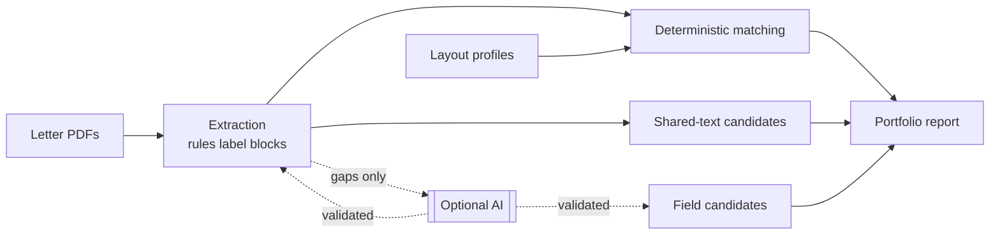

# Recipe draft: choose a letter layout with rules, let AI fill the gaps

> Draft for the Adobe Experience League AI Recipe Library. Not submitted and not reviewed by
> Adobe. Statements marked `UNVERIFIED` have not been checked against Adobe documentation.

## 1. Title and category

**Title:** Match letters to layout templates with a deterministic matcher and a measured AI
assist

**Category:** AEM Forms, Interactive Communications, content migration. (`UNVERIFIED`: the exact
category names of the library.)

## 2. Problem and objective

Moving a set of letters to a smaller set of templates starts with a manual question, asked for
every letter: which template does it belong to? Someone opens the PDF, compares the address,
subject and date positions with each template, checks whether the longest address still fits,
and writes the answer in a spreadsheet. The same person looks for wording that could become
reusable text, and for parts that change from letter to letter.

The objective is to do the comparison by rule, so that the answer is repeatable and explained,
and to keep people for the cases that need judgment: weak fits, near-ties and letters that fit
nothing. A model may help where rules have a gap. It does not choose the template, and each
thing it does is measured against the rules alone.

## 3. Architecture and workflow



- Letters are text-based PDFs. Layout profiles are JSON files with boxes in points.
- Extraction, labels, scores, the tie-break, duplicates and shared text are deterministic.
- AI is off by default. When on, its output is validated, marked and counted.

`UNVERIFIED`: how the parts relate to Interactive Communications. A layout profile plays the
part of a template's Master Page and Subform geometry. A shared-text candidate might become a
Document Fragment. A field candidate might bind to a Form Data Model. None of these mappings has
been checked, and the tool creates nothing in AEM.

## 4. Step by step

### 4.1 Install and create synthetic letters

```bash
python -m pip install -e ".[dev]"
icsel samples
icsel samples --portfolio
```

### 4.2 Describe the layouts

A profile is a page size and a list of zones:

```json
{"role": "address", "x": 72, "y": 144, "width": 252, "height": 86, "max_lines": 6, "required": true}
```

```bash
icsel show-layout classic-left --compare subject-right
```

### 4.3 Extract and label

Words become lines, lines become blocks, and ordered rules give each block a role. A block no
rule matches stays `unknown`. That is the gap AI may fill later.

```bash
icsel match samples/letters/L04-subject-right-3line.pdf
```

### 4.4 Match with hard checks and a score

Hard checks come first: line capacity, width, required zones, and letter or statement. Then each
role is scored (from `match.py`):

```python
closeness = max(0.0, 1.0 - math.hypot(dx, dy) / cfg.position_scale)
overlap = _overlap_fraction(block, zone)
s = cfg.closeness_share * closeness + (1 - cfg.closeness_share) * overlap
```

The output names the reason a layout was ruled out:

```text
L04-subject-right-3line.pdf
  subject-right         0.999  fits
  classic-left          0.473  DOES NOT FIT
      - subject has 3 lines; layout allows 2
```

### 4.5 Add AI for the gaps (optional)

The labeling prompt lists the allowed roles, gives positions for every block and text only for
the unknown ones, and allows "unknown" as an answer. The reply is then held to rules the prompt
cannot override (from `llm/assistant.py`):

```python
if b.role != "unknown" or b.role_source != "rules":
    continue  # only blocks the rules could not label, and only once
if s.role not in SUGGESTED_ROLES or s.role == "unknown" or s.confidence < min_confidence:
    continue
```

```bash
icsel match samples/letters --llm anthropic
```

Only send letters you may send to that service. The README has a table of what each task sends.

### 4.6 Look at the whole portfolio

```bash
icsel portfolio samples/portfolio --shared-text --proposals --out out/portfolio
```

The report has letters per layout, letters that fit nothing, weak fits, near-ties,
near-duplicates, shared-text candidates and proposed layouts. On the demo folder the run ends
with exit code 1, because the folder holds a scan and a corrupt file on purpose.

Shared text is found without a model. The `fragments` task can suggest a name per group. It sees
only the wording all letters of the group have in common.

### 4.7 Find variable fields (optional, sends letter text)

```bash
icsel portfolio samples/portfolio --llm anthropic --ai-tasks fields --fields-send-text
```

Each returned text must appear word for word in the letter and have a valid, unique name.
Anything else is dropped and counted.

## 5. Test and verify on your own machine

No AEM license and no real letters are needed. Everything is synthetic, for the fictional
company Brightwater Utilities.

```bash
python -m pytest
icsel eval samples/letters
```

The tests block network access and use scripted backends, including wrong ones. `icsel eval`
compares the rules, and the rules plus each AI task, with known answers. With no backend it
reports the rules only:

| Run | Role accuracy | Field precision | Field recall | Layout agreement | Boilerplate recall |
| --- | ---: | ---: | ---: | ---: | ---: |
| rules | 0.997 | 1.000 | 0.710 | 1.000 | 1.000 |

The layouts and letters were made together, so these numbers show that the tool works as
designed. They do not predict results on other letters. **No real model has been measured yet**;
run `icsel eval` with your backend and keep a task only if the report says it beats the rules.

## 6. Honest limits

- Text-based PDFs only. No OCR. Rules are tuned for English business letters.
- The tool does not read Interactive Communications templates. Profiles are measured by hand.
- The sample PDF is a local approximation of placement. It is not Interactive Communications
  output and does not reproduce its fonts, pagination, fragments or data.
- Shared text and fields are candidates for a person to review.
- `UNVERIFIED`: every mapping to Master Pages, Subforms, Document Fragments and Form Data Models,
  and every idea about APIs. See [production-path.md](production-path.md).

## 7. Community value

- A repeatable first pass over a letter set, with a reason for each choice.
- A pattern that carries over to other tasks: rules decide, AI fills gaps, replies are validated,
  and a benchmark decides whether the AI part stays.
- Synthetic letters with ground truth that others can use to compare approaches.

## Before you publish

- [ ] Check Experience League's current submission format and rules (not verified here).
- [ ] Re-run the tests and every command above on a clean clone.
- [ ] Run `icsel eval` with a real backend, or keep the statement that none was measured.
- [ ] Add the AEM mapping only from sources you have checked, and cite them.
- [ ] Remove or resolve each `UNVERIFIED` item ([REVIEW.md](../REVIEW.md) lists them).
- [ ] Confirm that text and images contain synthetic data only.
- [ ] Check how Adobe product names and marks may be used.
